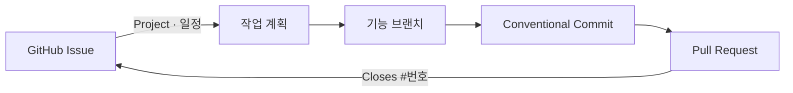

# my-skills

> sukkyun2의 Claude Code · Codex 업무 워크플로 스킬 모음

GitHub Issue를 작업의 시작점으로 삼아 브랜치, 커밋, PR까지 이어지는 흐름과
여러 저장소의 기본 브랜치 동기화를 제공합니다.

## 빠른 시작

### Claude Code

```text
/plugin marketplace add sukkyun2/my-skills
/plugin install dev-workflow@my-skills
```

### Codex

#### Plugin Marketplace 설치

다른 Codex 사용자에게 배포하거나 업데이트를 추적하려면 Marketplace로 설치합니다.

```bash
codex plugin marketplace add sukkyun2/my-skills --ref master \
  --sparse .agents/plugins --sparse .codex
```

그런 다음 Codex의 `/plugins`에서 **sukkyun2 Skills** Marketplace를 열고
**Dev Workflow**를 설치합니다. 설치 여부는 다음 명령으로 확인합니다.

```bash
codex plugin marketplace list
```

#### 저장소 개발용 동기화

저장소를 내려받은 뒤 다음 명령을 실행합니다.

```bash
scripts/sync-codex-skills.sh
```

`git-commit-pr`, `github-issue-create`, `git-sync-branches`가 사용자 범위에
설치됩니다. 기본 경로는 `~/.codex/skills/`이며, `CODEX_HOME`이 설정되어 있으면
`${CODEX_HOME}/skills/`를 사용합니다. 스킬을 수정한 뒤에도 같은 명령으로 다시
동기화합니다.

특정 프로젝트에서만 쓰려면 `.codex/skills/`를 대상 프로젝트의 같은 경로에
복사하거나 심볼릭 링크로 연결하면 됩니다.

## Codex 워크플로

Codex는 자연어 요청만으로 관련 스킬을 선택합니다. 확실히 지정하고 싶다면
`$스킬명`으로 시작하세요.



| 스킬 | 이런 요청에 사용 | 결과 |
| --- | --- | --- |
| `github-issue-create` | “이 작업 Issue 만들어줘” | 확인된 Issue, 담당자 지정, Project 및 일정 반영 |
| `git-commit-pr` | “커밋해줘”, “PR 열어줘” | 이슈 기반 브랜치, Conventional Commit, 연결된 PR |
| `git-sync-branches` | “dev/main 동기화 상태 보여줘” | Desktop workspaces의 안전한 로컬 브랜치 최신화 |
| `datadog-my-services` | “내 서비스 Datadog 에러 확인해줘” | mario·gms-java-api의 기본 서비스·환경·시간 범위 조회 |

## `github-issue-create`

작업 또는 버그 Issue를 초안으로 만들고, 사용자가 최종 확인하면 현재 저장소에
생성합니다.

### 생성 결과

- Issue 제목과 본문을 대화 내용에서 작성
- 현재 로그인 계정(`@me`)을 담당자로 지정
- 업무 문맥에 맞는 GitHub Project에 추가
- 제공된 시작일·목표일을 Project 필드에 기록
- 제공된 Teams 대화 링크를 Issue 본문에 보존
- 생성된 Issue 번호와 URL 보고

| 업무 문맥 | 기본 Project | 일정 필드 |
| --- | --- | --- |
| GMS / WMS | `wms-plan` · Project #33 | `Start date`, `Target date` |
| FOMS / OMS | `oms-plan` · Project #37 | `Start date`, `Target date` |
| 문맥 불명확 | 생성 전 Project 확인 | 입력된 날짜만 기록 |

본문은 유형에 따라 다음 항목을 채웁니다.

| 유형 | 본문 구성 |
| --- | --- |
| 작업 | `배경`, `완료조건`, 제공된 경우 `Teams 링크` |
| 버그 | `재현절차`, `완료조건`, 제공된 경우 `Teams 링크` |

```text
$github-issue-create 로그인 실패 오류를 GitHub Issue로 등록해줘

$github-issue-create GMS 배송 조회 작업을 시작일 2026-10-13,
목표일 2026-10-20으로 등록해줘

$github-issue-create 이 Teams 대화 링크를 포함해서 Issue로 등록해줘: <Teams URL>
```

제목·본문이 완성되면 반드시 초안을 보여주고 생성 확인을 받습니다. Teams 링크는
제공된 경우에만 넣으며, 없다고 별도로 묻지 않습니다. 라벨, 마일스톤, Issue type,
상위 Issue, 차단 관계는 별도 요청이 있을 때만 설정합니다. Project 추가나 일정 기록만
실패한 경우에는 Issue를 중복 생성하지 않고 부분 완료 상태를 보고합니다.

## `git-commit-pr`

변경사항을 GitHub Issue에 연결된 브랜치와 PR로 정리합니다. 커밋과 PR 본문은 실제
diff와 커밋 이력에 근거해 작성합니다.

### 만들어지는 결과

| 단계 | 예시 결과 |
| --- | --- |
| 브랜치 | `feat/123-login-error` |
| 커밋 | `fix(auth): 로그인 실패 원인 표시` |
| PR 레이블 | `behavior`, `structure`, `bug` 중 하나 |
| Issue 연결 | PR 마지막 줄의 `Closes #123` |

Issue 번호가 있으면 브랜치명에 포함하고 PR 본문 마지막 줄에 `Closes #번호`를
넣습니다. GitHub에서는 Issue의 **Linked pull requests**와 PR의 연결된 Issue가
양방향으로 표시되며, 기본 브랜치 병합 시 Issue가 자동으로 종료됩니다.

PR 본문은 한국어로 작성하되 아래 영문 섹션 라벨을 유지합니다.

```md
## Why (배경/문제)
### Teams 링크                       # 제공된 경우만
## What (변경 요약)
## How (접근/설계)
## Test (검증)
## TODO (배포 전 필요 작업)       # 필요한 경우만
## Review Focus (리뷰어가 봐주셨으면 하는 부분) # 필요한 경우만

Closes #123
```

`TODO`에는 실제 배포 시 남은 수동 작업만 체크박스로 넣고, `Test`에는 실제 실행한
테스트 또는 수동 검증만 기록합니다. Teams 링크가 제공되면 `Why` 하위에 보존하고,
없으면 해당 섹션을 제거합니다. 불확실한 내용을 채우기 위해 `없음`이나 `None`을 넣지
않습니다.

```text
$git-commit-pr GitHub Issue #123 기준으로 feat 브랜치 만들어줘
$git-commit-pr 현재 변경사항 커밋하고 푸시해줘
$git-commit-pr PR 만들어줘
$git-commit-pr Bypass 모드로 PR 만들어줘
```

| PR 모드 | 동작 |
| --- | --- |
| Normal | PR 전체 초안을 보여주고, 불확실한 내용만 확인한 뒤 생성 또는 수정 |
| Bypass | 추가 내용 질문 없이 diff·커밋 이력에 확인되는 정보만 사용 |

기능 브랜치에서는 요청에 포함된 커밋·push를 별도 재확인 없이 진행합니다. 다만
`dev`, `main`, `master`에 대한 push는 반드시 push 직전의 명시 승인이 필요합니다.
브랜치 생성, PR 생성, PR 수정도 실행 직전에 확인합니다.

## `git-sync-branches`

`~/Desktop/workspaces` 아래의 모든 Git 저장소에서 `origin/dev`와 `origin/main`을
로컬 브랜치에 안전하게 반영합니다. macOS LaunchAgent가 60분마다 실행하고 결과는
`~/.codex/logs/git-sync-branches.log`에 기록합니다.

```text
$git-sync-branches 현재 동기화 상태 보여줘
$git-sync-branches dry-run으로 확인해줘
```

- 없는 로컬 추적 브랜치는 생성합니다.
- 체크아웃되지 않은 로컬 브랜치는 fast-forward만 합니다.
- 원격에 브랜치가 없거나, 로컬이 ahead/diverged 상태이거나, 다른 worktree에서
  사용 중인 브랜치는 건너뜁니다.
- 자동 `merge`, `rebase`, `reset`, `stash`, 브랜치 전환은 하지 않습니다.

## `datadog-my-services`

Mario와 GMS Java API의 Datadog 조회에 서비스와 환경 기본값을 적용합니다.

| 저장소 | 기본 Datadog service | 기본 환경 |
| --- | --- | --- |
| `mario` | `mario` | `prod` |
| `gms-java-api` | `gms-java-api` | `prod` |

시간을 지정하지 않으면 최근 1시간을 KST 기준으로 조회합니다. 다른 저장소에서 서비스가
생략된 요청은 두 서비스를 함께 확인하며, 서비스·환경·기간을 명시하면 해당 값을 우선합니다.

```text
$datadog-my-services mario 어제 오후 3시부터 4시까지 에러 로그 확인해줘
$datadog-my-services 내 서비스들 상태 확인해줘
```

## 요구 사항과 호환성

- Issue/PR 생성에는 로그인된 `gh`와 저장소 쓰기 권한이 필요합니다.
- Project 추가·일정 기록에는 `project` 권한도 필요합니다.
- 기존 `jira-create`는 하위 호환용으로 남아 있지만 Codex가 자동 선택하지 않습니다.
  Claude Code 플러그인과 과거 설계 문서는 기존 Jira 구성을 유지합니다.

## 저장소 구성

```text
.claude/skills/                 Claude Code 스킬 원본
.codex/                         Codex plugin root (선별된 skills/와 .codex-plugin/plugin.json 포함)
.agents/plugins/marketplace.json Codex 개인·팀용 Marketplace 정의
.claude-plugin/marketplace.json Claude Code Marketplace 정의
plugins/dev-workflow/           플러그인 매니페스트 (skills/는 .claude/skills 심볼릭 링크)
scripts/sync-skills.sh          ~/.claude/skills/로 동기화
scripts/sync-codex-skills.sh    ~/.codex/skills/로 동기화
```
