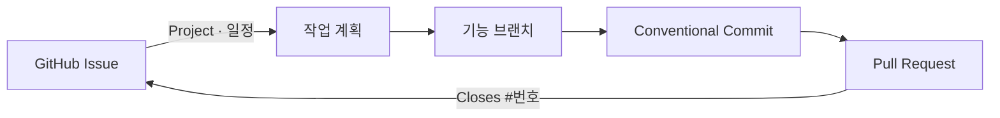

# my-skills

Codex용 개인 스킬 모음입니다.

- [빠른 시작](#빠른-시작)
- [스킬 한눈에 보기](#스킬-한눈에-보기)
  - [`github-issue-create`](#github-issue-create)
  - [`git-commit-pr`](#git-commit-pr)
  - [`git-sync-branches`](#git-sync-branches)
  - [`datadog-my-services`](#datadog-my-services)
- [저장소 구성](#저장소-구성)

## 빠른 시작

### Codex — Plugin Marketplace로 설치 (권장)

```bash
codex plugin marketplace add sukkyun2/my-skills --ref master \
  --sparse .agents/plugins --sparse .codex
```

Codex에서 `/plugins` → **sukkyun2 Skills** Marketplace → **Dev Workflow**를 설치합니다.
등록 여부는 다음 명령으로 확인합니다.

```bash
codex plugin marketplace list
```

### Codex — 저장소에서 직접 동기화 (스킬 개발용)

```bash
scripts/sync-codex-skills.sh
```

스킬이 사용자 범위에 설치됩니다. 스킬을 수정한 뒤에도 같은 명령으로 다시 동기화합니다.

| 조건 | 설치 경로 |
| --- | --- |
| 기본 | `~/.codex/skills/` |
| `CODEX_HOME` 설정 시 | `${CODEX_HOME}/skills/` |

특정 프로젝트에서만 쓰려면 `.codex/skills/`를 대상 프로젝트의 같은 경로에 복사하거나
심볼릭 링크로 연결합니다.

## 스킬 한눈에 보기



| 스킬 | 이런 요청에 | 결과 |
| --- | --- | --- |
| `github-issue-create` | “이 작업 Issue 만들어줘” | 담당자·Project·일정이 반영된 Issue |
| `git-commit-pr` | “커밋해줘”, “PR 열어줘” | Issue 기반 브랜치, Conventional Commit, 연결된 PR |
| `git-sync-branches` | “dev/main 동기화 상태 보여줘” | 로컬 `dev`·`main` 브랜치의 안전한 최신화 |
| `datadog-my-services` | “내 서비스 Datadog 에러 확인해줘” | 서비스·환경·기간 기본값이 적용된 Datadog 조회 |

---

## `github-issue-create`

작업·버그 Issue를 초안으로 보여주고, 사용자가 확인하면 현재 저장소에 생성합니다.

**동작**

- 대화 내용을 바탕으로 제목과 본문 작성
- 현재 로그인 계정(`@me`)을 담당자로 지정
- 업무 문맥에 맞는 GitHub Project에 추가
- 시작일·목표일이 주어지면 Project 필드에 기록

| 업무 문맥 | Project | 일정 필드 |
| --- | --- | --- |
| GMS | `wms-plan` (#33) | `Start date`, `Target date` |
| FOMS | `oms-plan` (#37) | `Start date`, `Target date` |
| 불명확 | 생성 전에 사용자에게 확인 | 입력된 날짜만 기록 |

**예시**

```text
$github-issue-create 로그인 실패 오류를 GitHub Issue로 등록해줘
$github-issue-create GMS 배송 조회 작업을 시작일 2026-10-13, 목표일 2026-10-20으로 등록해줘
$github-issue-create 이 Teams 대화 링크를 포함해서 Issue로 등록해줘: <Teams URL>
```

---

## `git-commit-pr`

변경사항을 GitHub Issue에 연결된 브랜치·커밋·PR로 정리합니다. 커밋 메시지와 PR 본문은
실제 diff와 커밋 이력에 근거해 작성합니다.

**결과 예시**

| 단계 | 예시 |
| --- | --- |
| 브랜치 | `fix/123-login-error` |
| 커밋 | `fix(auth): 로그인 실패 원인 표시` |
| PR 레이블 | `behavior`, `structure`, `bug` 중 하나 |
| Issue 연결 | PR 본문 마지막 줄 `Closes #123` |

Issue 번호가 있으면 브랜치명에 넣고, PR 본문 마지막 줄에 `Closes #번호`를 추가합니다.
GitHub에서 Issue와 PR이 서로 연결되어 표시되며, 기본 브랜치에 병합되면 Issue가 자동으로
닫힙니다.

**PR 본문 템플릿**

```md
## Why (배경/문제)
### Teams 링크                                   # 제공된 경우만
## What (변경 요약)
## How (접근/설계)
## Test (검증)
## TODO (배포 전 필요 작업)                       # 필요한 경우만
## Review Focus (리뷰어가 봐주셨으면 하는 부분)   # 필요한 경우만

Closes #123
```

**PR 모드**

| 모드 | 동작 |
| --- | --- |
| Normal (기본) | PR 초안 전체를 보여주고, 불확실한 부분만 확인한 뒤 생성·수정 |
| Bypass | 추가 질문 없이 diff·커밋 이력으로 확인되는 정보만 사용 |

**예시**

```text
$git-commit-pr GitHub Issue #123 기준으로 브랜치 만들어줘
$git-commit-pr 현재 변경사항 커밋하고 푸시해줘
$git-commit-pr PR 만들어줘
$git-commit-pr Bypass 모드로 PR 만들어줘
```

> [!IMPORTANT]
> 기능 브랜치에서는 요청에 포함된 커밋·push를 다시 묻지 않고 진행합니다.
> `dev`, `main`, `master`로의 push는 **push 직전에 반드시 명시적 승인**을 받습니다.

---

## `git-sync-branches`

`~/Desktop/workspaces` 아래 모든 Git 저장소에서 `origin/dev`, `origin/main`을 로컬
브랜치에 안전하게 반영합니다. macOS LaunchAgent가 60분마다 실행하며, 결과는
`~/.codex/logs/git-sync-branches.log`에 기록됩니다.

| 상황 | 처리 |
| --- | --- |
| 로컬 추적 브랜치 없음 | 생성 |
| 체크아웃되지 않은 브랜치 | fast-forward만 수행 |
| 원격 브랜치 없음 / 로컬이 ahead·diverged / 다른 worktree에서 사용 중 | 건너뜀 |

`merge`, `rebase`, `reset`, `stash`, 브랜치 전환은 자동으로 하지 않습니다.

**예시**

```text
$git-sync-branches 현재 동기화 상태 보여줘
$git-sync-branches dry-run으로 확인해줘
```

---

## `datadog-my-services`

Mario와 GMS API의 Datadog 조회에 서비스·환경 기본값을 적용합니다.

| 저장소 | Datadog service | 환경 |
| --- | --- | --- |
| `mario` | `mario` | `prod` |
| `gms-java-api` | `gms-java-api` | `prod` |

**기본값 규칙**

- 기간을 지정하지 않으면 **최근 1시간(KST)** 을 조회합니다.
- 위 두 저장소 밖에서 서비스를 생략하면 두 서비스를 함께 확인합니다.
- 서비스·환경·기간을 명시하면 그 값이 우선합니다.

**예시**

```text
$datadog-my-services mario 어제 오후 3시부터 4시까지 에러 로그 확인해줘
$datadog-my-services 내 서비스들 상태 확인해줘
```

## 저장소 구성

```text
.codex/                            Codex plugin root (선별된 skills/, .codex-plugin/plugin.json)
.agents/plugins/marketplace.json   Codex 개인·팀용 Marketplace 정의
scripts/sync-codex-skills.sh       ~/.codex/skills/로 동기화
```
